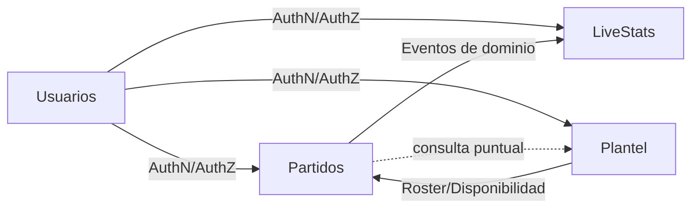

# Mapa de Bounded Contexts - Opción B (VoleyTrack)

## Objetivo
Definir límites de dominio para backend con **NestJS + Hexagonal + DDD** usando la opción B:

1. **Usuarios**
2. **Plantel** (Equipos + Jugadores)
3. **Partidos** (operación y reglas del juego)
4. **LiveStats** (lectura en vivo y estadísticas)

---

## Context Mapping (alto nivel)

### Tipo de relación sugerida
- **Partidos ← Plantel**: *Customer/Supplier* (Partidos consume datos de roster sin gobernar Plantel).
- **LiveStats ← Partidos**: *Published Language* + eventos de integración.
- **Todos ← Usuarios**: servicio de identidad/autorización transversal.

---

## 1) BC Usuarios

### Responsabilidad
Gestión de identidad y acceso (Admin, Planillero, Invitado), autenticación y políticas de autorización.

### Casos de uso cubiertos
- CU01 Registrar planillero
- CU02 Iniciar sesión
- CU03 Cerrar sesión
- CU04 Cambiar contraseña

### Aggregate roots sugeridos
- `User`
- `Credential`

### Invariantes clave
- Email/DNI únicos para cuentas operativas.
- Password hasheada (nunca texto plano).
- Solo Admin crea cuentas de Planillero.

### Eventos de dominio (ejemplos)
- `ScorerRegistered`
- `PasswordChanged`

---

## 2) BC Plantel

### Responsabilidad
Gestión de equipos, jugadores y composición de planteles habilitados para partido.

### Casos de uso cubiertos
- CU05 Crear jugador
- CU06 Actualizar jugador
- CU07 Eliminar jugador (baja lógica)
- CU08 Crear equipo
- CU09 Actualizar equipo
- CU10 Eliminar equipo (baja lógica)
- CU11 Asignar jugador a equipo
- CU12 Desasignar jugador de equipo
- CU13 Cambiar jugador de equipo

### Aggregate roots sugeridos
- `Team`
- `Player`

### Invariantes clave
- Un jugador no puede estar activo en dos equipos simultáneamente (misma temporada/contexto).
- Dorsal único por equipo (si aplica reglamento local).
- Jugador de baja lógica no puede asignarse a alineación.

### Eventos de dominio (ejemplos)
- `PlayerCreated`
- `PlayerAssignedToTeam`
- `PlayerTransferred`
- `TeamDeactivated`

---

## 3) BC Partidos

### Responsabilidad
Orquestar encuentro, sets, marcador, rotaciones, sustituciones y reglas de negocio de vóley.

### Casos de uso cubiertos
- CU14 Crear partido
- CU15 Modificar partido
- CU16 Iniciar partido
- CU17 Crear alineaciones
- CU18 Modificar alineaciones
- CU19 Asignar saque inicial
- CU20 Iniciar set
- CU21 Anotar punto
- CU22 Deshacer punto
- CU23 Realizar sustitución
- CU24 Terminar set
- CU25 Terminar partido

### Aggregate roots sugeridos
- `Match`
- `Set`

### Invariantes clave
- Reglas RN-01..RN-06 (25/15 puntos, diferencia de 2, deuce, tie-break, límite de cambios y excepción líbero).
- Atomicidad al registrar punto (RNF-02).
- Partido finalizado bloquea nuevas acciones.

### Eventos de dominio (ejemplos)
- `MatchStarted`
- `SetStarted`
- `PointRegistered`
- `PointUndone`
- `SubstitutionPerformed`
- `SetFinished`
- `MatchFinished`

---

## 4) BC LiveStats

### Responsabilidad
Modelo de lectura en vivo para pizarra, timeline y estadísticas por partido/jugador/set.

### Casos de uso cubiertos
- CU26 Visualizar partido en vivo
- CU27 Visualizar estadísticas en vivo

### Patrón sugerido
- **Read Model / CQRS Query Side** alimentado por eventos de `Partidos`.
- Publicación por WebSocket (RNF-01 <= 1.5s).

### Proyecciones (ejemplos)
- `LiveScoreboardProjection`
- `LiveTimelineProjection`
- `PlayerStatsProjection`

---

## Fronteras y Ownership de datos

- `Usuarios` es dueño de credenciales y roles.
- `Plantel` es dueño de entidades Equipo/Jugador y su relación.
- `Partidos` es dueño del estado de encuentro y eventos de juego.
- `LiveStats` **no** es dueño del estado transaccional del partido; consume eventos y materializa consultas.

Regla de oro: **ningún contexto escribe tablas de otro contexto**.

---

## Evolución B -> C (futuro)

La opción B puede escalar a C separando `Plantel` en `Equipos` y `Jugadores` si se mantiene:

1. Integración por puertos (no por SQL cross-context).
2. IDs estables (`TeamId`, `PlayerId`).
3. Eventos de integración explícitos.
4. Anti-corruption layer temporal durante migración.
